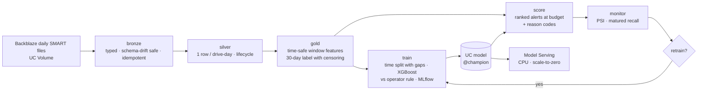

# DriveGuard — predictive storage failure intelligence

[](https://github.com/wenjun78/driveguard/actions/workflows/ci.yml)

End-to-end ML engineering on real hardware telemetry: **which drives in a fleet should an operator inspect or replace
this week, before they fail?** Built on [Backblaze Drive Stats](https://www.backblaze.com/cloud-storage/resources/hard-drive-test-data)
(daily SMART snapshots of ~300k production drives), as a Databricks lakehouse pipeline — PySpark medallion tables,
MLflow + Unity Catalog model lifecycle, budgeted batch alerting with reason codes, drift and matured-label monitoring,
condition-triggered retraining, Asset Bundle jobs, CI — and a public **fleet console** that reads it all live.
Runs on Databricks Free Edition; runs identically on a laptop.

**Live console:** [driveguard-kf09.onrender.com](https://driveguard-kf09.onrender.com) — ranked alerts with reason codes and hindsight, matured-label monitoring, model lifecycle, job runs, what-if scoring ([how it works](docs/console.md)). Reads the Databricks workspace live; replaying the held-out period one day per real day since 1 Nov 2026.

**Headline (real data, <!--dg:split.test_days-->90<!--/dg-->-day held-out test):** <!--dg:test.drive_recall0-->71<!--/dg--> % of the <!--dg:test.failing_drives-->120<!--/dg--> drives that failed were on the daily list within their last 30 days, median lead <!--dg:test.lead_median-->18<!--/dg--> days, at a budget of 0.5 % of the fleet; the operator's five-counter rule catches <!--dg:rule.drive_recall0-->5<!--/dg--> % at the same budget.



## What makes it an ML *system*, not a notebook

| concern | what DriveGuard does |
|---|---|
| **Label** | `fails within (t, t+30]`. Drives that leave the fleet or hit the end of the data before `t+30` are **censored** (NULL), not labelled healthy. The failure-day row is excluded as the outcome, not a decision point. |
| **Time safety** | Every feature is a function of the drive's past only; windows are range frames over *calendar days*, not row counts. A test deletes the future and asserts features are unchanged. No calendar-monotone features. |
| **Evaluation** | Strictly time-ordered train / val / test with **horizon-long unlabeled gaps**, so training labels never depend on validation-period outcomes. Optional held-out drive *models* (`test_unseen`). |
| **Metrics that match the decision** | Per day the top 0.5 % of the fleet is flagged. Reported: recall / precision **at that budget**, per-drive recall, **lead time** of the first alert, false alerts per 1,000 healthy drive-days — alongside PR-AUC. |
| **The bar** | The operator's rule (Backblaze's five SMART counters, non-zero ⇒ alert) goes through the identical budgeted evaluation. The model must beat it on the same test days. |
| **Lifecycle** | MLflow pyfunc with the feature spec and a drift reference sample inside the artefact; Unity Catalog registration; `@champion` reassigned only once the incumbent's held-out test period has elapsed on the replay clock *and* validation PR-AUC ≥ the incumbent's (read from its own run); challengers trained before that are registered without the alias. |
| **Operations** | `gold_risk_alerts`: score, per-day rank, flag, top-3 TreeSHAP reason codes; `replaceWhere` makes re-runs idempotent. `ops_monitoring`: PSI on key features and on scores, **real** precision/recall back-filled once each snapshot's 30 days have elapsed, and a `retrain_recommended` task value that gates the retrain task in the daily job. |
| **Platform** | Delta tables in UC, serverless jobs from a Databricks Asset Bundle, optional CPU serving endpoint, GitHub Actions running lint + unit + end-to-end tests on local Spark and building the wheel. |
| **Console** | FastAPI + static UI over the same tables, model, endpoint and jobs (SQL warehouse, MLflow/UC, Model Serving, Jobs API), cached and quota-safe, with a bundled snapshot fallback that is always labelled as such. **Replay clock**: the daily job advances one data-day per real day, so the fleet visibly moves and matured outcomes catch up. |

Details: [`PROJECT_CASE_STUDY.md`](PROJECT_CASE_STUDY.md) (full engineering case study) · [`docs/evaluation.md`](docs/evaluation.md) ·
[`docs/architecture.md`](docs/architecture.md) · [`docs/data.md`](docs/data.md) · [`docs/databricks.md`](docs/databricks.md) ·
[`docs/console.md`](docs/console.md)

## Run it from GitHub (nothing to install)

Everything runs from this repository: tests and the wheel in CI, data loading and the first pipeline run in a
one-click workflow, daily operation on a schedule, and the console on Render straight from the repo.

1. **Databricks Free Edition** workspace → create a personal access token (Settings → Developer → Access tokens)
   and a SQL warehouse (SQL Warehouses → Create; the default is fine).
2. **Repository settings → Secrets and variables → Actions**: secret `DATABRICKS_TOKEN`; variable `DATABRICKS_HOST`
   (`https://<workspace>.cloud.databricks.com`). Optional variables: `DATABRICKS_HTTP_PATH` (detected if absent),
   `DG_REPLAY_ANCHOR` (e.g. `2025-01-01@2026-11-01` — the replay clock).
3. **Actions → `databricks-bootstrap` → Run workflow.** It downloads the Backblaze quarters on the runner, keeps ~10 %
   of drives with whole histories, uploads them to the Unity Catalog Volume, deploys the bundle, runs the build job
   (bronze → silver → gold → train → 45-day scoring replay → monitor), exports the console snapshot from the live
   workspace and commits it. 1–2 hours, mostly download and the first Spark run.
4. **Render → New Blueprint → this repo** (`render.yaml`). Add the same `DATABRICKS_HOST`, `DATABRICKS_TOKEN`,
   `DATABRICKS_HTTP_PATH` and `DG_REPLAY_ANCHOR` as environment variables and the console goes live; without them
   it serves the committed snapshot, which after step 3 is real data too.
5. The **`daily`** workflow (02:40 UTC) runs the Databricks daily job — with `DG_REPLAY_ANCHOR` set, bronze lands
   exactly one more historical day per real day (later days wait in the Volume), scoring and monitoring follow, and
   retraining happens only when the monitor says so — then publishes a fresh console snapshot.
6. The **`fetch-quarters`** workflow (Mondays) looks for Backblaze quarters newer than the Volume holds, downloads
   and uploads them; the next daily run ingests them, so the fleet keeps moving as Backblaze publishes.

## Quickstart on a laptop

**Synthetic fleet (3 minutes, no download):**

```bash
pip install -e ".[local,dev]"
make fixture            # 3,000 synthetic drives × 400 days in the Backblaze file layout -> data/raw
make demo               # bronze -> silver -> gold -> train -> 45-day scoring replay -> monitor
python scripts/report.py
pytest -q               # 34 tests incl. an end-to-end run, the console API and the lifecycle gates
uvicorn driveguard.app.server:app   # the console on http://localhost:8000 (demo snapshot until Databricks is configured)
```

**Real data, by hand (the workflows do exactly this):**

```bash
# whole drive histories for ~10 % of the fleet, three quarters, the SMART columns the pipeline uses
python scripts/download_backblaze.py --quarters 2024Q3 2024Q4 2025Q1 --serial-frac 0.10 --out data/raw
make demo                                                   # locally, or:
databricks fs cp -r data/raw dbfs:/Volumes/workspace/driveguard/raw
databricks bundle deploy -t dev && databricks bundle run -t dev driveguard_build
# then point the console at the workspace (Render env vars or locally): DATABRICKS_HOST, DATABRICKS_TOKEN, DATABRICKS_HTTP_PATH
```

Free Edition notes, table names, knobs and the daily job are in [`docs/databricks.md`](docs/databricks.md).

## Results

### Real data — Backblaze 2024Q3–2025Q1, 10 % of the fleet

<!--dg:data.drives-->33,144<!--/dg--> drives with whole histories (hash-selected by serial), <!--dg:data.failures-->366<!--/dg--> failures, Jul 2024 – Mar 2025; run on Databricks
Free Edition serverless by the `databricks-bootstrap` workflow. Time-ordered split with <!--dg:split.gap-->30<!--/dg-->-day gaps: training ends
<!--dg:split.train_end-->2 Sep 2024<!--/dg-->, validation <!--dg:split.val_start-->3 Oct 2024<!--/dg--> – <!--dg:split.val_end-->1 Dec 2024<!--/dg-->, test <!--dg:split.test_start-->1 Jan 2025<!--/dg--> – <!--dg:split.test_end-->31 Mar 2025<!--/dg--> (<!--dg:split.test_days-->90<!--/dg--> days). Alert budget 0.5 % of the fleet per
day (≈<!--dg:test.alerts_per_day-->156<!--/dg--> drives). Champion: `workspace.driveguard.driveguard_failure_30d` v<!--dg:champion.version-->4<!--/dg-->.

| metric | validation | test | operator rule (test) |
|---|---|---|---|
| PR-AUC | <!--dg:val.pr_auc-->0.145<!--/dg--> | <!--dg:test.pr_auc-->0.184<!--/dg--> | <!--dg:rule.pr_auc-->0.017<!--/dg--> |
| ROC-AUC | <!--dg:val.roc_auc-->0.839<!--/dg--> | <!--dg:test.roc_auc-->0.924<!--/dg--> | <!--dg:rule.roc_auc-->0.863<!--/dg--> |
| Drive recall @ budget (flagged ≥ once in the 30 d before failure) | <!--dg:val.drive_recall-->57.0<!--/dg-->% | <!--dg:test.drive_recall-->70.8<!--/dg-->% | <!--dg:rule.drive_recall-->5.0<!--/dg-->% |
| Recall @ budget (drive-days) | <!--dg:val.recall-->39.1<!--/dg-->% | <!--dg:test.recall-->45.3<!--/dg-->% | <!--dg:rule.recall-->1.5<!--/dg-->% |
| Precision @ budget | <!--dg:val.precision-->8.6<!--/dg-->% | <!--dg:test.precision-->13.5<!--/dg-->% | <!--dg:rule.precision-->0.5<!--/dg-->% |
| Median lead time of first alert (days) | <!--dg:val.lead_median-->23<!--/dg--> | <!--dg:test.lead_median-->18<!--/dg--> | <!--dg:rule.lead_median-->8<!--/dg--> |
| Caught with ≥ 7 d lead | <!--dg:val.caught_7d-->84<!--/dg-->% | <!--dg:test.caught_7d-->79<!--/dg-->% | <!--dg:rule.caught_7d-->67<!--/dg-->% |
| False alerts / 1,000 healthy drive-days | <!--dg:val.false_alerts-->4.59<!--/dg--> | <!--dg:test.false_alerts-->4.47<!--/dg--> | <!--dg:rule.false_alerts-->5.03<!--/dg--> |
| Failing drives in period | <!--dg:val.failing_drives-->100<!--/dg--> | <!--dg:test.failing_drives-->120<!--/dg--> | <!--dg:rule.failing_drives-->120<!--/dg--> |
| Labeled drive-days | <!--dg:val.rows_labeled-->1,773,979<!--/dg--> | <!--dg:test.rows_labeled-->1,845,383<!--/dg--> | <!--dg:rule.rows_labeled-->1,845,383<!--/dg--> |

Read it as an operator would: **of the <!--dg:test.failing_drives-->120<!--/dg--> drives that failed in the test period, <!--dg:test.drive_recall0-->71<!--/dg--> % were on the daily list at
least once in their last 30 days, with a median <!--dg:test.lead_median-->18<!--/dg--> days' warning**; the list is <!--dg:test.precision-->13.5<!--/dg--> % "right" per drive-day at a
budget of 0.5 % of the fleet, against a <!--dg:test.base_rate-->0.15<!--/dg--> % base rate. The five-counter rule operators are given is a *flag*, not
a ranking: at the same budget it surfaces the drives with the largest counter values — mostly old survivors — and
catches <!--dg:rule.drive_recall0-->5<!--/dg--> % of failures. Live, matured-label recall on the replayed snapshots in the bundled snapshot (as of <!--dg:data.as_of-->1 Jan 2025<!--/dg-->)
runs <!--dg:live.matured_range-->0.3–0.4 per day (median ≈ 0.3)<!--/dg-->; the retraining floor is half the champion's own held-out recall (<!--dg:live.floor-->23<!--/dg--> %).

These figures are rewritten by `scripts/refresh_docs.py` from the console snapshot whenever the champion changes,
and `@champion` is only reassigned once the replay has passed the incumbent's held-out period, so the numbers above
are always those of the model that is scoring the fleet.

**Live replay (since 1 Nov 2026).** The daily job runs on the replay clock with `DG_REPLAY_ANCHOR=2025-01-01@2026-11-01`:
the console's "today" started at 1 Jan 2025 and advances one data-day per real day, walking through the champion's
held-out test period — every replayed alert is on a day the model never trained or validated on. Matured outcomes,
drift and the retraining decision accrue day by day at [driveguard-kf09.onrender.com](https://driveguard-kf09.onrender.com);
the `fetch-quarters` workflow adds Backblaze quarters as they are published so the replay never runs out of road.

Regenerate the table: `python scripts/report.py` against the workspace (or read `app_snapshot/model.json`).

### Synthetic dry run — proves the pipeline only

3,000 synthetic drives × 400 days (1.03 M drive-days, 127 failures, exaggerated 4 % AFR), 2 CPU cores, local Spark:
bronze 31 s · silver 21 s · gold 35 s · train 38 s · 45-day scoring replay 28 s · monitor 14 s.

| metric | Validation | Test | Operator rule (test) |
|---|---|---|---|
| PR-AUC | 0.548 | 0.548 | 0.513 |
| Recall @ budget (drive-days) | 57.7% | 57.5% | 52.1% |
| Precision @ budget | 36.0% | 49.1% | 45.6% |
| Drive recall @ budget | 75.0% | 73.3% | 73.3% |
| Median lead time (days) | 15 | 22 | 18 |
| Caught with ≥ 7 d lead | 81% | 91% | 86% |
| False alerts / 1,000 healthy drive-days | 3.42 | 2.96 | 3.09 |
| Failing drives in period | 28 | 30 | 30 |

The fixture's degradation *is* the five counters the operator rule watches, so a small margin over the rule is the
expected outcome there; the point of the table is that every stage runs, the metrics are the operational ones, and
the comparison against the rule is wired in. Real-data numbers replace this section.

## Repository

```
src/driveguard/        the system: config, spark/table store, bronze, silver, gold, splits, model, train, scoring, score, monitor, metrics, replay, cli
src/driveguard/app/    the console: FastAPI server, Databricks live source, snapshot source (+ DuckDB twin for exports)
web/, app_snapshot/    console UI (no build step) and the bundled demo snapshot
notebooks/             Databricks notebooks 01-07 — thin wrappers that pass widgets to the package
resources/jobs.yml     Asset Bundle jobs: one-off build; daily ingest -> score -> monitor -> condition -> retrain
databricks.yml         bundle, variables, wheel artifact, targets
scripts/               download_backblaze.py (subset by serial hash) · make_fixture.py (synthetic fleet) · report.py · export_snapshot.py
render.yaml, Dockerfile  deploy the console (Render free tier, or any container host)
tests/                 label semantics, censoring, time safety, schema drift, splits, budgeted metrics, PSI, end-to-end
docs/                  evaluation protocol, architecture, data notes, Databricks guide
.github/workflows/     ci (lint, tests, wheel, bundle deploy) · databricks-bootstrap (data -> Volume -> deploy -> build run -> snapshot) · daily (job run + snapshot) · fetch-quarters (new Backblaze data)
```

## Limitations, stated plainly

* Training happens on the driver on a negatives-sampled set (all positives + 20× negatives, weighted). That is the right
  trade at fleet scale for a tabular model, but it is not distributed training.
* Free Edition quotas mean "subset first". The pipeline is the same at 100 % of the fleet; the compute is not.
* The synthetic fixture is for tests and dry runs. Nothing computed from it is a result.
* Serving is a CPU endpoint for the champion; the operational surface is the batch alert table.
* The console is read-only and cached; until the Backblaze subset has been run in a workspace it shows the synthetic demo snapshot, labelled as such on every page.

## Attribution and licence

Data: Backblaze Drive Stats, used with attribution per Backblaze's terms. Code: MIT © 2026 wjun78.
